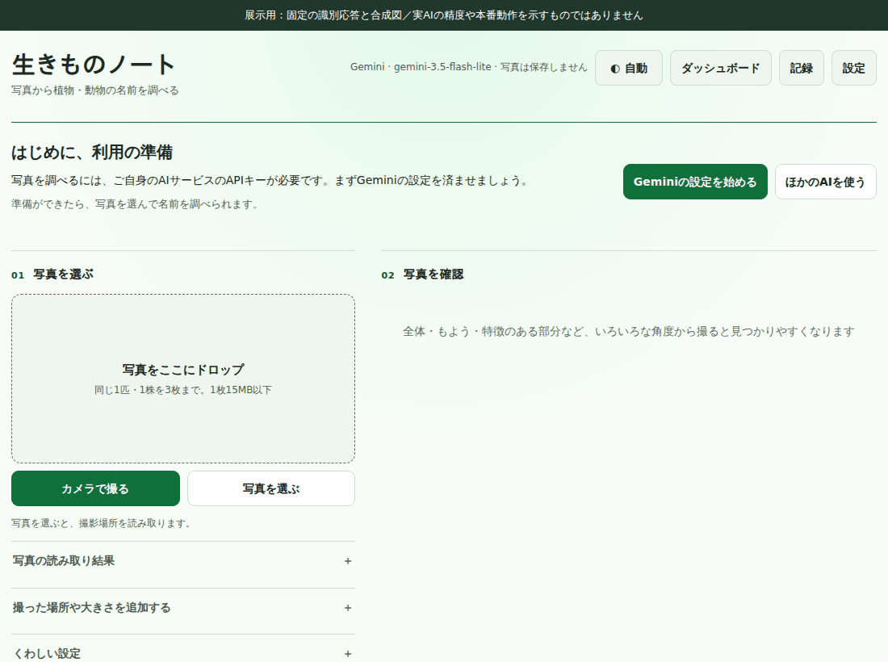
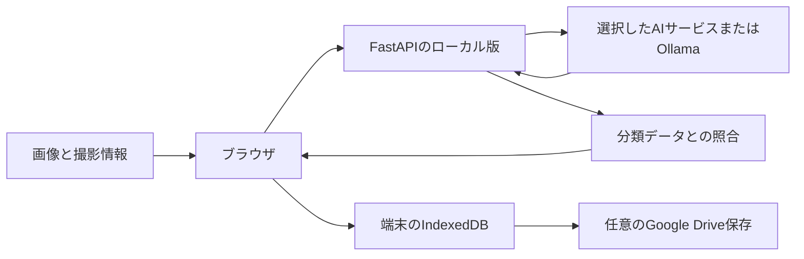

# 生きものノート

写真から植物や動物の候補を調べ、判断の根拠と不足している情報を記録するWebアプリです。
AIの回答に分類データとの照合を加え、名前の実在確認と写真からの識別を分けて表示します。

このリポジトリは、AIを活用したアプリ開発のポートフォリオとして、アプリのソースを独立させた公開版です。
ローカルで起動できるPython版と、Cloudflare版の構成を読むための参考ソースを収録しています。

[既存の公開アプリ](https://ikimono-note.ats030.workers.dev/)では、通常利用にGoogleログインと利用者自身のAI APIキーが必要です。
APIキーを用意せずに流れを見る場合は、以下の画面と[操作動画](docs/media/walkthrough.webm)をご覧ください。



**展示は実際のUIを操作し、識別応答を固定したものです。**
入力画像も合成図です。
実AIの識別精度、Google認証、Drive同期、本番環境の動作を証明する動画ではありません。

画面を静止画で読む場合は、[初回設定](docs/media/02-settings.png)、[候補と不足理由](docs/media/04-result.png)、[保存した記録](docs/media/05-history.png)を参照してください。

## 解決する課題

名前だけが返る識別結果では、利用者が似た種を比較したり、撮り足す部分を判断したりする材料が足りません。
生きものノートは最大3枚の画像と任意の撮影情報から候補を示し、写真上の特徴、識別点、不足する情報を表示します。
確証が不足していても候補を黙って消さず、その理由を残します。

食用可能性や採取の可否は断定しません。
分類データに名前が存在することも、その写真がその種であることの保証にはなりません。

## 実装から読める設計判断

| 課題 | 実装した対応 | 根拠を読める場所 |
| --- | --- | --- |
| AIが返した学名をそのまま信用できない | 分類データとの照合と証拠の確認を分ける | [vision.py](vision.py)、[pipeline.py](pipeline.py) |
| 写真の決め手が足りない | 不足理由と追加撮影の案内を表示する | [結果表示](static/assets/index.js)、[UIの検査](tests/test_app.py) |
| 記録の一覧に大きい画像を読み込む必要がない | 一覧用の縮小画像と詳細用画像を分ける | [記録保存](static/assets/index.js)、[履歴表示](static/assets/history.js) |
| DriveのJSONに画像をまとめると更新単位が大きくなる | 画像を別ファイルに置き、JSONは参照と小さい画像を持つ | [Drive連携](static/assets/gdrive.js)、[持ち出し形式](static/assets/backup.js) |
| 写真の位置情報をそのまま送信したくない | 送信用画像の再エンコードと撮影情報の明示的な扱いを分ける | [画像処理](vision.py)、[撮影情報](static/assets/photo-location.mjs) |

これらはコードで確認できるプロジェクトの実装です。
改善前後の速度や容量削減率、個人の発案や担当範囲を、測定や確認なしで実績として記載していません。
[写真保存の設計事例](docs/photo-storage.md)に、処理の流れと制約をまとめています。

## 構成



図はこのリポジトリで起動できるローカル版の経路です。
既存の公開版はCloudflare Workersを入口にし、Geminiの経路ではブラウザで画像を準備して入口側で処理します。
Python版と公開版は実行経路が異なります。
[構成と収録範囲](docs/architecture.md)で、その違いを説明しています。

| 用途 | 技術 |
| --- | --- |
| 画面と記録 | HTML、CSS、JavaScript、IndexedDB |
| ローカルAPI | Python、FastAPI、Pillow |
| AIと分類照合 | プロバイダー別の構造化要求、分類APIとの照合 |
| 公開版の参考実装 | JavaScriptの入口Worker、Python Worker、D1連携 |
| 検証 | pytest、Playwright、PythonとJavaScriptの要求形式の比較 |

## ローカルで起動する

Python 3.12と、インターネットに接続して依存パッケージを取得できる環境を使います。

```sh
git clone https://github.com/ats030/ikimono-note.git
cd ikimono-note
python3 -m venv .venv
.venv/bin/python -m pip install -r requirements.txt
.venv/bin/python scripts/run_local.py
```

`http://127.0.0.1:8531/` を開きます。
起動スクリプトは設定とDBを、このリポジトリ内のGit対象外の `.local/` に保存します。
継承したAPIキーやクラウド設定を使わず、ローカルだけで待ち受けます。
識別を実行する場合は設定画面で自分のAI接続を設定してください。
実APIの費用や利用条件は、そのサービスで確認してください。

この起動方法は運営者モードです。
設定を変更できるため、このままインターネットへ公開する運用には対応していません。
ブラウザ内での画像処理を使うWorker用の依存ファイルと、実環境の配備設定は収録していません。

## 検証と展示の再生成

Node.jsはプロバイダー要求形式の比較テストに使います。
PlaywrightのChromiumは画面の検査と撮影に使います。

```sh
.venv/bin/python -m pip install -r requirements-dev.txt
.venv/bin/python -m playwright install chromium
.venv/bin/python scripts/run_checks.py
.venv/bin/python scripts/capture_portfolio.py
.venv/bin/python scripts/audit_publication.py
```

撮影スクリプトは外部リクエストを拒否し、固定応答で実際の画面を操作します。
初回設定、画像選択、不確実な候補、IndexedDBへの保存、再読込み後の記録保持を確認します。
[検証記録](docs/validation.md)には実行環境、結果、既知の制約を記載します。

## AIの利用と公開範囲

この公開版の整理、説明文の作成、展示スクリプトの実装には生成AIを利用しています。
元の開発について、個々の設計を誰が発案したかや、人とAIの実装比率はこの公開版では主張していません。
評価の材料として、実装、検証方法、制約を読める形にしています。

運用用のリポジトリ履歴、認証情報、利用者の写真、観察記録、個人の設定は収録していません。
第三者のコードとデータの出典は[THIRD_PARTY_NOTICES.md](THIRD_PARTY_NOTICES.md)、収録元の検証用ハッシュは[source-manifest.json](docs/source-manifest.json)を参照してください。
プロジェクト全体へのオープンソース再利用ライセンスは、今回の公開では設定していません。
