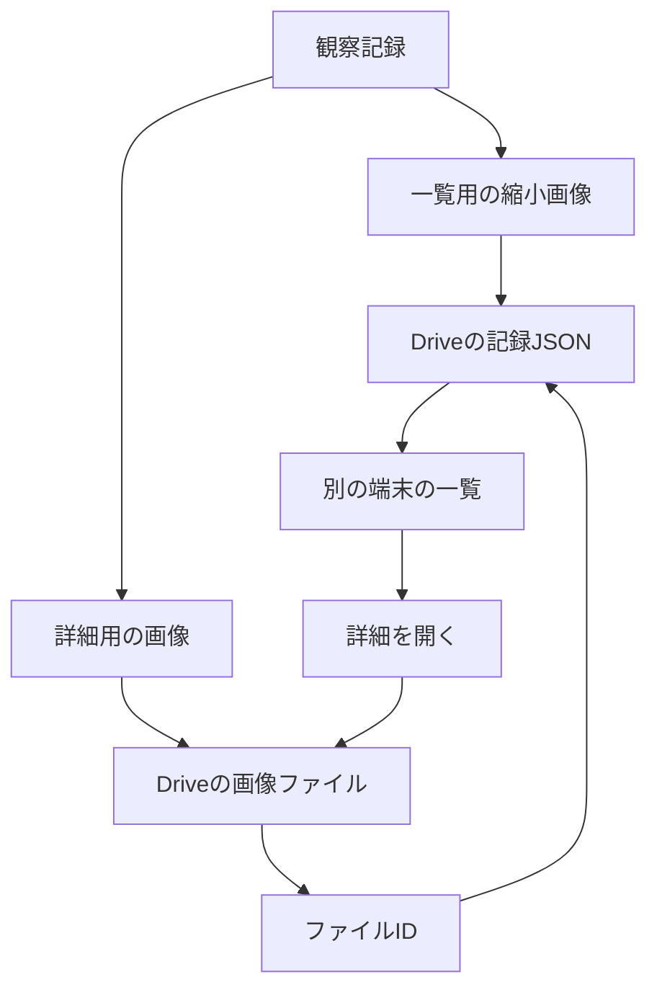

# 写真保存の設計事例

一覧表示と写真の詳細表示では、必要な画像の大きさが違います。
生きものノートは、その違いを記録形式と読込みのタイミングに反映しています。

## 一覧と詳細の読込み

[saveHistory](../static/assets/index.js)は、識別に使った画像と一覧用の小さい画像をIndexedDBへ保存します。
[履歴表示](../static/assets/history.js)は一覧に `listThumbnail` を使い、拡大時には詳細用の画像を選びます。
古い記録に一覧用の画像がない場合は、既存の画像を使う互換経路があります。

## Driveへ保存する単位

[uploadPendingPhotos](../static/assets/gdrive.js)は、画像を記録のIDと画像の順番を含む別ファイルとして保存し、返されたIDを `drivePhotos` に記録します。
1回の保存でアップロードする画像は6枚までです。
[持ち出し形式の作成](../static/assets/backup.js)は、Drive用のJSONから大きい画像を外し、一覧用の画像とファイル参照を残します。

別の端末で記録を開くときは、[fetchRecordPhotos](../static/assets/gdrive.js)が参照先の画像を取得します。
取得した画像は端末内にも保存されるため、詳細表示は手元の画像を使えます。
Drive側に画像がまだない記録では、取得できる詳細画像もありません。

## この公開版で確認した範囲

コード上の保存形式と、展示のブラウザで記録が再読込み後も残ることを確認します。
実アカウントでのDrive保存は展示では実行しません。
容量削減率や同期時間の比較は新たに測定していないため、性能改善の数値は記載しません。
この設計を個人の発案として紹介するには、別途担当範囲の確認が必要です。
